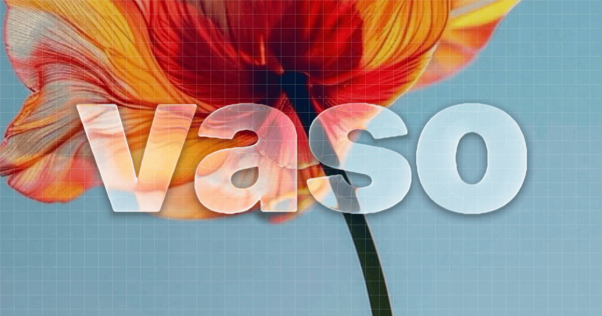

# Vaso

A beautiful liquid glass distortion effect component for React that creates stunning visual magnification and warping effects.



## Installation

```bash
npm add vaso
```

<details>
<summary>Install the agent skill</summary>

```sh
npx skills add huozhi/vaso --skill vaso
```

The skill teaches compatible coding agents when and how to use Vaso. The full agent reference is at
[vaso-react.vercel.app/llms.txt](https://vaso-react.vercel.app/llms.txt).

</details>

## Quick Start

```tsx
import { Vaso } from 'vaso'

function App() {
  return (
    <Vaso radius={16} depth={1.2} blur={0.5} outset={12}>
      <p>This text sits under a liquid glass</p>
    </Vaso>
  )
}
```

## API Reference

### Props

| Prop | Type | Default | Range | Description |
|------|------|---------|-------|-------------|
| `children` | `React.ReactNode` | - | - | Content rendered on top of the glass. Without children, set `width` and `height` to size the glass |
| `component` | `string \| React.ComponentType` | `'div'` | - | The element or component to render as the glass root, e.g. `'span'` for inline glass |
| `width` | `number` | `undefined` | - | Explicit width of the glass element (overrides child element size) |
| `height` | `number` | `undefined` | - | Explicit height of the glass element (overrides child element size) |
| `outset` | `number \| { x, y, top, right, bottom, left }` | `0` | - | Extends the glass beyond the element without affecting layout. A number applies to every side; sides take precedence over axes |
| `px` / `py` | `number` | `0` | - | **Deprecated**, use `outset={{ x, y }}` |
| `radius` | `number` | inherited | `0-∞` | Border radius of the glass. Defaults to the element's computed `border-radius`, so classes like `rounded-full` just work |
| `depth` | `number` | `0` | `-5.0 to 5.0` | Refraction strength at the bezel (negative values create a concave, compressing glass) |
| `blur` | `number` | `0.1` | `0-10` | Backdrop blur in pixels |
| `dispersion` | `number \| false` | `0.5` | `0-3.0` | Spectral (rainbow) dispersion along the refracting edge, like Figma's glass. Scales with the glass size and fades out as `depth` approaches 0 |
| `specular` | `number \| false` | `0.5` | `0-1.0` | Intensity of the specular rim highlight |
| `light` | `number \| 'pointer'` | top left | `0-360` | Where the light comes from: an angle in degrees (0 above, 90 right), or `'pointer'` to follow the cursor |
| `pressable` | `boolean` | `false` | - | Swell under a press, with a small lens forming under the finger |
| `ripple` | `boolean` | `false` | - | Send a ripple through the glass from every tap |

`<Vaso>` forwards `ref` to its root element.

### `<VasoGroup>`

Glass that merges. Every `<Vaso>` inside becomes part of one glass, and members that come close flow into each
other like drops of water. Move members however you like (CSS transitions, transforms, an animation library); the
group follows them every frame.

| Prop | Type | Default | Description |
|------|------|---------|-------------|
| `smooth` | `number` | `24` | Width of the liquid neck between members, in px. `0` joins them without blending |
| `depth`, `blur`, `dispersion`, `specular`, `light` | | | As on `<Vaso>`, for the whole group (`depth` defaults to `1`) |
| `overflow` | `number` | `64` | How far past the group's box members may reach and still be glass |

Members keep their own `outset` and `radius`; the group's props decide how the glass looks. The other glass props (`depth`, `blur`, `light`, ...) belong on the group, and members don't support `pressable` or `ripple` yet; setting them on a member logs a warning in development. In Safari and Firefox the
group refracts a copy of the backdrop, like a single `<Vaso>` does there.

### Browser Support

The refraction is rendered with an SVG filter inside `backdrop-filter`, which is currently only supported by Chromium based browsers (Chrome, Edge, Arc, Opera, ...).

Safari and Firefox don't render those, so Vaso refracts a copy of what's behind the glass instead, with no extra setup:

- It clones the nearest ancestor with visible content (text, images, video, canvas or a background), leaving out every glass layer and anything stacked above this glass.
- The clone is kept aligned every frame, so dragging, scrolling and transitions stay in sync. Videos and canvases are mirrored into it frame by frame.
- DOM changes re-clone it, swapping only once the new clone's images and videos have loaded. Style changes (themes, late stylesheets) refresh it without cloning.
- Transparent areas are filled with the color behind the content, so nothing shows through twice.

Limits: sources larger than 400 elements aren't cloned (the glass keeps its blur and rim instead), and CSS that depends on an ancestor outside the cloned element may style the copy differently. Glass far outside the viewport pauses its copy until it scrolls back near it.

## Without React: `vaso/core`

The glass itself has no framework dependency. `createGlass` turns any element into glass; the `<Vaso>` component
is a thin wrapper around it, so both behave the same, including the Safari and Firefox fallback.

```js
import { createGlass } from 'vaso/core'

const glass = createGlass(document.querySelector('.toolbar'), { depth: 1.2, blur: 0.5, outset: 4 })

glass.update({ depth: 2 }) // merges into the current options; cheap enough for every animation frame
glass.destroy() // removes everything the glass added

// Merging glass: one group, any number of members
const group = createGlassGroup(document.querySelector('.bar'), { smooth: 32, depth: 1.2 })
const member = group.add(document.querySelector('.search-button'))
member.remove()
```

Options are the props above, without `component` and `children`. `createGlassGroup` works in every browser, with the same backdrop copy as `createGlass` in Safari and Firefox. The element's own content stays on top of
the glass.

## Examples

### Glass around content

The glass sizes itself to its children. `outset` lets it reach past them without moving anything.

```tsx
<Vaso radius={24} depth={1.2} blur={0.5} dispersion={0.6} outset={{ x: 8, y: 4 }}>
  <button>Share</button>
</Vaso>
```

### Lens with an explicit size

Without children, give the glass a size and place it over whatever it should refract.

```tsx
<div style={{ position: 'relative' }}>
  
  <Vaso
    width={120}
    height={120}
    radius={60}
    depth={2.5}
    style={{ position: 'absolute', left: 40, top: 40 }}
  />
</div>
```

### Concave lens

A negative `depth` compresses what's behind the glass instead of magnifying it.

```tsx
<Vaso width={60} height={60} radius={30} depth={-4} dispersion={1.5} />
```

### Radius from CSS

Leave out `radius` and the glass follows the element's own `border-radius`.

```tsx
<Vaso className="rounded-full" depth={1.4} outset={4}>
  <span>Dark</span>
</Vaso>
```

### Merging glass

Members that touch melt into one shape. Here a button sits beside a bar; widen it in CSS and it flows out of it.

```tsx
<VasoGroup smooth={32} depth={1.2}>
  <Vaso className="toolbar">…</Vaso>
  <Vaso className="search-button">…</Vaso>
</VasoGroup>
```

### Press and ripple

```tsx
<Vaso pressable ripple light="pointer" radius={44} depth={1.4} blur={1.2}>
  <Player />
</Vaso>
```

### Frosted panel

A high `blur` with a bright rim reads as frosted glass.

```tsx
<Vaso radius={20} depth={0.3} blur={6} specular={0.9}>
  <div className="p-4">Settings</div>
</Vaso>
```

## Development

`pnpm dev` builds the package, watches it and serves the demo site on http://localhost:3000.
[`validation/`](./validation) has browser checks for it: smoke tests, cross-browser comparisons, performance and A/B
regressions, in Chromium, WebKit and Firefox.

## License

MIT

